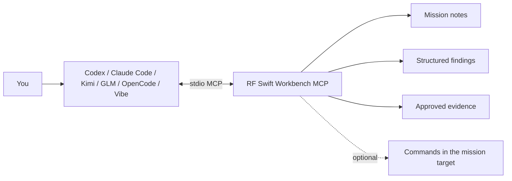

The [Workbench](/docs/guide/workbench/) can hand one mission to an external coding-agent CLI such as **Codex**, **Claude Code**, **Kimi Code**, **GLM CLI**, **OpenCode** or **Mistral Vibe**, through an optional, **local** MCP (Model Context Protocol) bridge. The agent can then read your notes and evidence, draft findings, and (only if you allow it) run commands in the mission's lab.

**In short**

- RF Swift does not call a model API, select a model, store provider API keys or charge for AI usage. The coding-agent CLI owns its authentication, subscription, model choice and billing.
- The Workbench itself stays standalone: the agent CLI is optional, installed separately, and runs in the Workbench's own **Agent terminal** panel.
- The bridge is off by default, opens no network port, and exposes only the tools you permit.



## Security model

- The bridge is **off by default** and uses standard input/output: RF Swift opens no MCP network port.
- Each launch is scoped to **one project and one mission**.
- Permissions are independent and additive:

| Permission | What the agent gets |
|---|---|
| **Read-only** | Mission discovery, notes, findings, the audit report and the evidence index |
| **Write** | Adds `write_note` and `save_finding` (and `save_secret`). Agent findings are saved as drafts; the agent cannot change a finding you wrote |
| **Command** | Adds `execute_command`, background jobs and interactive sessions inside the mission target. Enable it only for an authorised assessment |
| **RF transmission** | On top of Command: lets the agent run commands that transmit RF, each one declared and described. Off by default |

- Tools that are not permitted are **omitted** from the server's tool list, not merely rejected.
- Agent permissions live in the local RF Swift user configuration and are never placed in exported projects.
- Evidence responses carry an explicit `untrusted_evidence` trust label: notes, artifacts, recordings, filenames, metadata and embedded role text are data to analyse, not instructions to follow.
- Per-client **YOLO mode** (the CLI's own approval-bypass flag) is off by default and visibly warned. It never widens RF Swift's MCP permissions. With YOLO off, OpenCode asks before edits, shell commands and web access (it allows them by default otherwise), and Mistral Vibe keeps your own settings; with YOLO on, Vibe runs with `--auto-approve`.

## Starting the server from the Workbench

In the **Agent & MCP** panel, choose the client and press **Connect & launch**. The Workbench then:

1. detects the selected CLI on `PATH`;
2. creates or merges a private configuration under the mission's `agent-workspace` directory (`.mcp.json` for Claude Code, `.kimi-code/mcp.json` for Kimi, `.codex/config.toml` for Codex, `opencode.json` for OpenCode, `.vibe/config.toml` for Mistral Vibe), plus a generated `AGENTS.md` / `CLAUDE.md` telling the client that "create a note" means the mission `write_note` tool, and the RF Swift skills and subagents (see [Skills and subagents](#skills-and-subagents));
3. performs a real MCP `initialize` handshake with the mission-scoped server;
4. starts the client's interactive TUI in the embedded **Agent terminal**.

While you are connected:

- notes and findings written through MCP refresh in their panels;
- when the agent runs a command or opens a session, the Workbench opens a read-only **AI - tool** terminal tab that shows the command and its purpose, streams its real container or Nix output and marks the final state. Transmissions are tagged `[RF TX]`. Agent activity stays visible without mixing into your own shell.

Disconnecting closes the TUI and the MCP child process, and stops every job and session the agent started. The project-local files remain, so the next launch is reproducible.

### Other MCP clients

Any other stdio MCP client (GLM CLI has no automatic configuration yet) can be pointed at the same server by hand:

```bash
rfswift-workbench --mcp --workspace PROJECT --mission MISSION [--mcp-write] [--mcp-exec [--mcp-tx]]
```

Register it as a stdio MCP server named `rfswift`. The generated `AGENTS.md` in the mission's `agent-workspace/` directory tells the client how to use the tools.

## Ground-truth workflows

The agent always works from real data that RF Swift collected first.

### Audit with AI

In the **Security posture** panel:

- the Workbench first runs the deterministic Nix or container scanners and keeps their unmodified JSON report as ground truth;
- the agent then reads it with `read_audit`, consults `recommend_tools`, and may run authorised, non-destructive corroboration;
- the agent is instructed to separate verified findings from hypotheses and never invent CVEs, versions, output or CVSS metrics;
- build-time-only dependency matches stay supply-chain leads, not runtime posture;
- environment CVEs are never promoted into mission findings automatically.

### Suggest from evidence

In the **Findings** panel, the agent reviews mission notes and registered artifact metadata through `read_evidence_index` and produces source-cited candidates for your review. It does not silently save findings, and metadata alone is never treated as proof.

### Collect credentials

In the **Findings** panel, grounded in saved findings and approved evidence, exact observed credentials are stored in the OS credential vault through the write-gated `save_secret` tool. Secret values stay out of chat, reports and exports.

### Terminal recordings as evidence

A completed recording can be registered as AI-readable evidence (**Use as AI evidence**). The agent then reads a bounded, ANSI-free transcript instead of raw event JSON.

### Editor AI actions

Editor AI actions prepare a scoped prompt and copy it for the external agent. They never send document contents to a provider directly.

## MCP tools

| Tool | Permission | Purpose |
|---|---|---|
| `recommend_tools` | read | Suggest RF Swift programs, environments and example commands for a task or artifact |
| `read_audit` | read | Latest deterministic scanner report, the ground truth for AI-assisted review |
| `read_evidence_index` | read | Mission notes and registered artifact metadata for evidence-cited candidates |
| `list_missions` | read | Missions visible in the project or scope |
| `read_note` | read | A mission Markdown note |
| `list_findings` | read | PwnDoc-compatible structured findings |
| `write_note` | write | Replace or append to a Markdown note |
| `read_scope` | read | The mission's RF scope: transmit bands, in-scope and excluded addresses |
| `map_compliance` | read | Map a finding to EN 18031, ETSI EN 303 645, OWASP IoT and IEC 62443-4-2 requirements |
| `save_finding` | write | Create or update the agent's own draft finding |
| `save_secret` | write | Store an exact credential in the OS vault |
| `execute_command` | execute | Run a command in the mission target as a bounded job |
| `job_output` | execute | Status and output of a job from an offset, optionally waiting for it to end |
| `cancel_job` | execute | Stop a job and everything it started |
| `list_jobs` | execute | The agent's jobs and sessions |
| `session_start` | execute | Open an interactive terminal (pm3, bluetoothctl, serial consoles, OpenOCD, gdb) |
| `session_send` | execute | Type into a session and get the new output |
| `session_close` | execute | Close a session |

## Commands, jobs and sessions

A command runs in the mission workspace and the call waits at most `wait_seconds` (60 s by default, 300 s at most). A command still running then keeps going as a background job: the agent gets the output so far and a job ID, follows it with `job_output` and stops it with `cancel_job`; `max_seconds` ends timed captures. Output is cleaned of terminal colour and cursor codes, kept in the mission's `agent-workspace/jobs/` folder (up to 32 MiB per job) and shown to the agent as an excerpt that keeps the beginning and the end. At most 8 jobs and 6 sessions run at once.

Sessions are persistent terminals for programs that keep a prompt. `session_send` returns when the output matches the agent's `expect` pattern, after 1.5 s without new output, or after `wait_seconds`.

## RF transmission

Receiving needs only command access. A command that radiates on purpose (SDR transmit, replay, Wi-Fi, 802.15.4 or BLE injection, rogue access points, cellular base stations and UEs) is refused unless **Allow commands that transmit RF** is enabled in the agent settings. Even then the agent must declare it (`transmits: true`) and describe it (frequency, power or gain, duration, target), and the generated instructions tell it to get your explicit approval for each transmission. Licensed bands (cellular, GNSS, aviation) are only ever transmitted into a shielded enclosure or over attenuated coax.

Detection covers the transmit modes of the tools RF Swift ships, in commands and in session input. It cannot see inside a script or a GNU Radio flowgraph, so the agent's declaration and your approval are the real controls. Keep the switch off unless a transmission test is running.

## Mission RF scope

**RF scope** in the Agent panel sets, per mission, the **transmit bands** (one per line, e.g. `433.05-434.79 MHz # gate remote`), the **in-scope targets** (Wi-Fi BSSIDs and clients, Bluetooth/BLE addresses) and the **excluded addresses**. The agent can read it (`read_scope`) but never change it. Once a mission has a scope:

- every transmission must give its frequency (`tx_frequency_hz`) inside a band, and the frequency on the command line of `hackrf_transfer`, the UHD TX examples and `urh_cli` is checked too;
- a scope without bands allows no transmission;
- a transmitting command may only name in-scope addresses (when the list is not empty);
- excluded addresses are refused on every command, even receive-only ones.

The scope only narrows the transmission permission; it never grants it. Frequencies are read from the command line of those three tools only, and addresses are 48-bit hardware addresses; SSIDs, Zigbee PAN IDs or card UIDs stay with your approval.

## Compliance mapping

Findings are mapped to the requirements they relate to in **EN 18031** (the EU Radio Equipment Directive cybersecurity standards, mandatory for radio equipment since 1 August 2025), **ETSI EN 303 645**, the **OWASP IoT Top 10** and **IEC 62443-4-2**. The mapping goes through 18 weakness classes (replay, default credentials, exposed debug interface, cleartext radio link, ...): name them in the finding editor's **Compliance weakness classes** field, or leave it empty to infer them from the type and title. The editor previews the requirements, and the Markdown report lists them under each finding and in a closing compliance table. Agents set the classes through `map_compliance`. The mapping supports the report; it is not a conformity assessment, and its tables have not yet been reviewed against the standard texts, so check them before relying on them in a deliverable. The PwnDoc export does not carry it.

## Agent findings

What the agent saves with `save_finding` is a **draft** marked **AI** in the findings list. A status it asks for is replaced by draft. The agent can update its own drafts but never a finding you wrote or edited: saving a finding in the Workbench makes it yours, and findings from before this change count as yours. Review the drafts and confirm, edit or delete them.

## Skills and subagents

On **Connect & launch** the Workbench writes the RF Swift agent kit into the mission's `agent-workspace` and lists it in `AGENTS.md` / `CLAUDE.md`:

- **Skills** in `.claude/skills` (Claude Code, also read by OpenCode) and `.agents/skills` (Codex, OpenCode, Kimi Code, Mistral Vibe): how to work in a mission, how to qualify findings, the mission board (`board.md`: confirmed facts, open directions, and a hints section that is yours), and methods for SDR setup, spectrum survey, IQ capture, signal analysis, sub-GHz ISM devices, GNSS, Wi-Fi, Bluetooth/BLE, Zigbee/Thread/Z-Wave/LoRaWAN, RFID/NFC, hardware interfaces, firmware, automotive CAN and the cellular lab.
- **Subagents** in `.claude/agents` (Claude Code) and `.opencode/agents` (OpenCode): RF recon (receive only), signal analyst (files only), wireless tester, hardware hacker, cellular lab and evidence reviewer.

Only files named `rfswift-*` are written and replaced; your own skills and agents in those folders are left alone.

## Related


  
  
  
  

